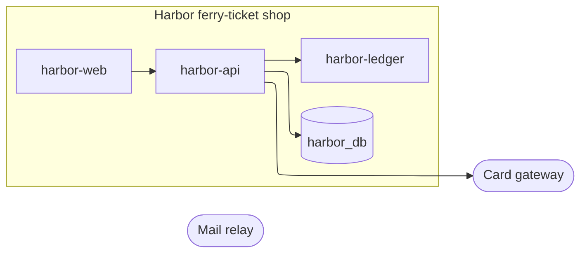

# harbor: containers (L2)

Generated by `c4-map gen` between the markers; prose outside them is kept.

<!-- c4-map:begin containers -->

| node | level | kind | status | evidence |
|---|---|---|---|---|
| `card_gateway` | containers | external | exists | deploy `harbor-api/deploy/k8s.yaml` key `CARD_GATEWAY_URL` |
| `harbor_api` | containers | container | exists | repo `harbor-api@def7c12`; deploy `harbor-api/deploy/k8s.yaml` |
| `harbor_db` | containers | store | exists | deploy `fakedeploy qa harbor-ledger`; deploy `harbor-api/deploy/k8s.yaml` key `API_DB_HOST` |
| `ledger` | containers | container | exists | repo `harbor-ledger@0989d68` |
| `mail_relay` | containers | external | exists | deploy `harbor-api/deploy/k8s.yaml` key `MAIL_RELAY_URL` |
| `web` | containers | container | exists | repo `harbor-web@6c88101` |

| from | to | evidence |
|---|---|---|
| `harbor_api` | `card_gateway` | deploy `harbor-api/deploy/k8s.yaml` key `CARD_GATEWAY_URL` |
| `harbor_api` | `harbor_db` | deploy `harbor-api/deploy/k8s.yaml` key `API_DB_HOST` |
| `harbor_api` | `ledger` | deploy `harbor-api/deploy/k8s.yaml` key `LEDGER_URL` |
| `web` | `harbor_api` | curated `context.md` |
<!-- c4-map:end containers -->
