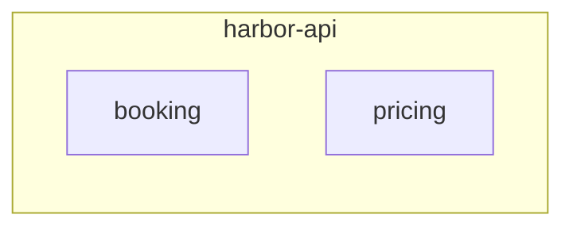

# harbor: modules (L3): harbor_api

Generated by `c4-map gen` between the markers; prose outside them is kept.

<!-- c4-map:begin modules harbor_api -->

| node | level | kind | status | evidence |
|---|---|---|---|---|
| `harbor_api__booking` | modules | module | exists | repo `harbor-api/src/booking` |
| `harbor_api__pricing` | modules | module | exists | repo `harbor-api/src/pricing` |
<!-- c4-map:end modules harbor_api -->
