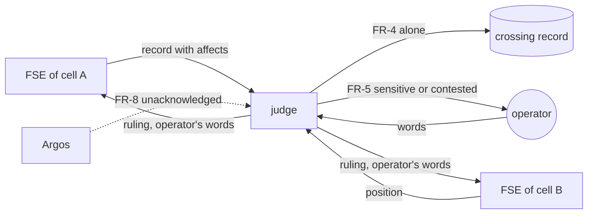

# Reconciler: a judge and coordinator for decisions that cross cells

status: proposed
owner: pablo (the factory's operator)
decisions: [factory decisions.md 2026-10-18 "decisions between FSEs need a registry and a reconciler", 2026-10-18 "the standing rule is the operator's away mode", 2026-10-18 "Argos", 2026-09-29 the word "reconciler" (persona cells)]
card: `fse-reconciler` (agent-slack working-on), evidence on the card (8907e7b)

## Problem

Pablo needs every decision that touches more than one cell to have one
place where it is asked, judged, applied and acknowledged. Today each FSE
rules inside its own initiative, Hephaistos carries messages between cells
by hand, and nobody owns a decision that crosses cells (Pablo, 2026-10-18:
"when two fse speaks, we need a registry of the decision making and a
reconciliator role… a judge, a coordinator. We need to design this along
evidence we already have along our work").

The evidence: 15 cases between 09-28 and 10-18 (on the card).
- **One cell's decision changes another, 6 times.** Twice the affected FSE
  was never told: hestia 0016 forwards camp's client data, and hestia 0026
  ruled organizer's push.
- **Relays are slow, lost or one-way, 5 times.** The delay runs from 8
  minutes to 15 hours. Organizer 0097's relay to camp never arrived, and an
  organizer stage sat blocked for 7 days.
- **One rule is read two ways**: camp 0011, which says noon, against the
  other cells, which say midnight.
- **An FSE holds a belief that contradicts a fact**, 3 times.
- **Duplicate questions across cells**, twice.
- **Pablo has to repeat a ruling** in the seat's own session, again and
  again, whenever it reached the seat by relay.

The one clean case, agent-slack 0011, had one owner and one record, and
each cell pointed to it.

**Appetite:** two waves. The first adds the registry fields and the judge
seat; the second adds Argos findings and away-mode handling.

## Premises

| # | Premise | Shown by | Read |
|---|---|---|---|
| P1 | Decision records share one front matter: status, raised_by, owner, ruled, ruled_by, options, chosen, cards, threads. There is no `affects:` field and no per-cell acknowledgement. | `~/claudecode/skills/working-on/templates/decision.md:1-16` | 2026-10-18 |
| P2 | `role-relay <role> <home-cell> <agent>` turns any cell's `[for <role>]` thread into mail for one seat, handles follow-ups, and closes copies once the source closes. | `~/claudecode/bin/role-relay` docstring; factory-tooling.md l.584 | 2026-10-18 |
| P3 | Persona cells already have a reconciler whose loop is: pull, consolidate, post a `decision`, record it, tell those affected. It escalates rather than iterating. "Acting as a lead because you are the reconciler" is listed as an anti-pattern. | `discuss` skill, "If you are the reconciler"; camp `agents/cell.json` `"reconciler": "po_andrea"` | 2026-10-18 (research subagent) |
| P4 | A seat's safety check refuses a ruling that reaches it by relay or by default when the ruling sends data off the Mac or changes permissions. It needs the operator's own words in that seat or in Hephaistos's session, and sometimes his hands. | 0026 refused twice (Data Exfiltration), 2026-10-18; org bitácora l.146-147; camp bitácora l.72-77 | 2026-10-18 |
| P5 | Needs-me shows a question older than 30 minutes as a long-wait row. | organizer 0014, 0135, 0139 | 2026-10-18 (research subagent) |
| P6 | Argos samples every seat and the mailbox every 3 minutes, with must, should and could findings. | card factory-pulse; shadow run 2026-10-18 12:37 | 2026-10-18 |
| P7 | agent-slack is the factory's own initiative and has decision records in `working-on/decisions/`. | `ls ~/agent-slack/working-on/decisions` | 2026-10-18 |

## Goals

- Every cross-cell decision has one **crossing record** that says which
  cells it affects, what each cell thinks, how sensitive it is, who ruled it
  and how, and whether each cell applied and acknowledged it.
- One **judge** seat owns crossings. It decides the cases it may decide
  alone, takes the rest to the operator with each FSE's position side by
  side, and carries the ruling to every affected cell.
- No relay is lost. A cell that has not acknowledged a crossing shows up,
  and Argos flags it.

## Non-goals

- The judge does not rule inside one initiative. A decision that touches
  only its own cell stays with that cell's FSE.
- It does not replace Hephaistos for the factory's own tooling. A crossing
  about a tool is still built by Hephaistos.
- It does not merge initiatives' records into one database. Each cell's
  record stays in that cell; the crossing links to them.

## Requirements

- **FR-1 The crossing record.** The judge shall keep crossing records in
  `~/agent-slack/working-on/decisions/` in the decision template plus these
  fields:
  - `kind`: contract, data-crossing, lane, rule-reading or dependency;
  - `affects`: the cells;
  - `positions`: per cell, agree, object or silent, with the time;
  - `sensitivity`: none, data-off-mac, client-data or permission;
  - `ruled_by`: the operator in words, judge, or away mode;
  - `applied` and `acknowledged`: per cell, with the commit or thread.

  Its status shall move proposed → awaiting-cells → ruled → applied →
  acknowledged.
- **FR-2 Raising.** When a cell's record names `affects:` with another
  cell, or a thread `[for judge]` arrives, the judge shall open a crossing
  within one wake and post the question to every affected FSE.
- **FR-3 Affects field.** The decision template shall gain an optional
  `affects: []` field. The `fse` skill shall require it on a record that
  changes another cell's config, scope, data or contract. Such a record is
  not ruled in its own cell until its crossing is ruled.
- **FR-4 Judge alone.** The judge shall rule alone only:
  - (a) details that follow from records already ruled;
  - (b) dependency bookkeeping: telling a cell that what it waits on has
    landed;
  - (c) pointing a cell at a question already ruled elsewhere (adopting the
    answer stays that cell's call);
  - (d) the narrower reading of an ambiguous rule until the operator
    clarifies, told to every cell.
- **FR-5 To the operator.** The judge shall send to the operator, with each
  FSE's position side by side and its own recommendation:
  - a crossing that changes another cell without that FSE's yes;
  - any crossing whose `sensitivity` is not none;
  - a lane change;
  - every other crossing not covered by FR-4.
- **FR-6 Away mode.** While the operator's away mode is on, the judge may
  take its recommendation after five minutes, but never on a crossing whose
  `sensitivity` is not none. Those wait for the operator, because the safety
  check refuses them anyway (P4).
- **FR-7 Carrying the ruling.** When a crossing is ruled, the judge shall
  post the ruling, in the operator's own words with where he said them, to
  every affected FSE. It marks each cell `acknowledged` only when that FSE
  answers in the thread.
- **FR-8 Never lost.** If a cell has not acknowledged within 30 minutes of
  the ruling, Argos shall raise a **should** finding `crossing:<id>:<cell>`.
  At 2 hours it becomes a **must**, routed to the judge.
- **FR-9 One judge.** The judge shall be one machine-wide role seat, woken
  through `role-relay judge agent-slack judge` like Talos. A cell's own
  reconciler (camp's po_andrea) keeps deciding inside its persona cell.

- **FR-10 Minimax regret** (Pablo, 2026-10-18: "the judge shall work under:
  La minimizacion del maximo arrepentimiento criteria"). Every ruling and every
  recommendation the judge makes shall carry a regret table:
  - **Rows:** the options.
  - **Columns:** the scenarios that matter, namely what could turn out true
    that would make one option the right one. Each scenario comes from the
    evidence: the FSEs' positions, the premises, and past cases.
  - **Cells:** the cost of that option if that scenario is true, in hours of
    factory or operator work lost.
  - **Irreversible harm** (data that left the Mac, a client boundary
    crossed, a permission granted, a deletion) is written as `irreversible`
    and outranks any number of hours.

  The regret of a cell is its cost minus the lowest cost in its column. The
  judge picks the option with the smallest worst-case regret. A tie goes to
  the more reversible option. The table is part of the crossing record, so
  the operator can see why, and so can challenge a scenario or a cost.

## Change on the map

No base map for agent-slack yet (`docs/architecture/` is empty); Daedalus
to be asked for one. The diagram below uses descriptive ids
only, so `diagram-check` is not run.

## Acceptance → gate

| # | FR | Given / When / Then | Check | Expected |
|---|---|---|---|---|
| G1 | FR-1, FR-3 | Given the template, when a record has `affects: [organizer]`, then tidy-check accepts the new fields and flags a ruled record with an unruled crossing | `tidy-check` on a fixture | a warning names the record |
| G2 | FR-2 | Given a `[for judge]` thread in hestia, when role-relay scans, then the judge wakes and opens a crossing posting to both FSEs | live run on fixture cells | crossing file plus 2 threads |
| G3 | FR-4 | Given a dependency crossing whose card merged, then the judge marks it ruled (b) and tells the waiting cell | fixture | ruled_by: judge, kind dependency |
| G4 | FR-5, FR-6 | Given a data-off-mac crossing in away mode, when 5 min pass, then nothing is ruled and the operator is asked | fixture | status awaiting-cells, a question to the operator |
| G5 | FR-7, FR-8 | Given a ruled crossing with one cell silent, when 31 min pass, then Argos shows a should `crossing:<id>:<cell>` | Argos on fixture | the finding |
| G6 | — | Replay of 0026: hestia raises push for organizer | drill in organizer-fixture plus a second fixture cell | goes to the operator as data-off-mac, never ruled by default, organizer asked |
| G8 | FR-10 | Given the 0026 replay, when the judge recommends, then its regret table shows 'push now' with irreversible regret if organizer objects, and 'wait for the operator' with a regret of hours | fixture | the judge recommends waiting, and the table is in the record |
| G7 | — | End to end: one real crossing (the next one Hephaistos would have relayed) goes through the judge | docs/runs/ | positions, ruling, all acknowledged |

## Boundary

- May touch: `~/claudecode/skills/` (new `judge` skill; `fse` and
  `working-on` for `affects:`), `~/claudecode/skills/working-on/templates/decision.md`,
  `~/claudecode/bin/tidy-check` (fields only), Argos's pulse (the crossing
  finding), `~/agent-slack/working-on/decisions/`, factory-tooling.md, the
  judge's prelude.
- Must not touch: any initiative's own records (they gain `affects:` only
  when their FSE writes the next record); the discuss server.
- No-gos: the judge never rules a sensitive crossing; it never speaks as
  the operator; it never edits another cell's files.

## Rabbit holes

- A crossings database or UI. A file per crossing plus Deltagos's existing
  Needs-me is enough until it is not.
- Backfilling the 15 historical cases as crossings. Only open ones (0026,
  camp 0014 vs organizer 0054) are migrated.
- Making the judge smart about initiative content. It judges cross-cell
  process and consistency; content stays with each FSE.

## Open questions

- [NEEDS CLARIFICATION: the role's name. "judge" is the working name;
  Hephaistos proposes **Themis** (the Greek titaness of order and fair
  judgement) to match Hephaistos and Argos — pablo]
- [NEEDS CLARIFICATION: a seat of its own (FR-9, recommended: the evidence
  shows relays fail when they ride another role's attention) or a duty of
  Hephaistos — pablo]

## Assumptions

- Crossing records live in agent-slack's `working-on/decisions/` (the
  factory's initiative) rather than a new store.
- Away mode exists as the operator's switch (card `operator-away-mode`);
  until it does, FR-6 reads "never".

## Alternatives considered

- **Hephaistos keeps relaying.** This is what produced the 15 cases: the
  relay depends on Hephaistos's attention, and Hephaistos must not rule.
- **Each FSE asks the other directly.** That works for agreement, but
  nobody owns a disagreement or a silence (0097, 0026).
- **Reuse camp's persona reconciler.** Its scope is one persona cell's
  deliberation; it has no access to other cells.

## Cards

| Card | Gate rows | Boundary | Depends on |
|---|---|---|---|
| judge-registry | G1, G3 | template, tidy-check, judge skill, decisions folder | — |
| judge-seat | G2, G4, G6 | prelude, role-relay wiring, fse skill | judge-registry, operator-away-mode |
| judge-argos | G5 | Argos pulse | factory-pulse, judge-registry |
| (run) | G7 | docs/runs | all three |

## Amendments

- 2026-10-18: FR-10 minimax regret added, Pablo's criterion for the judge; gate G8.
